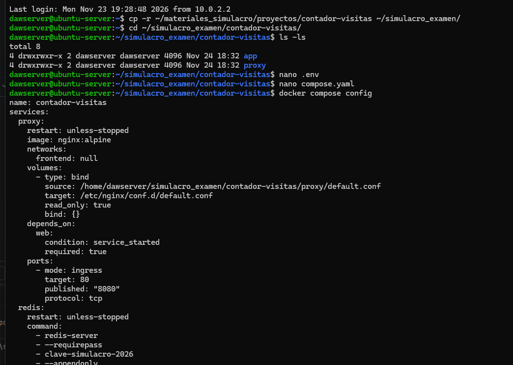
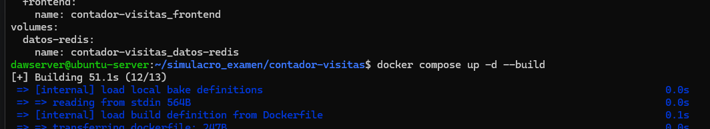
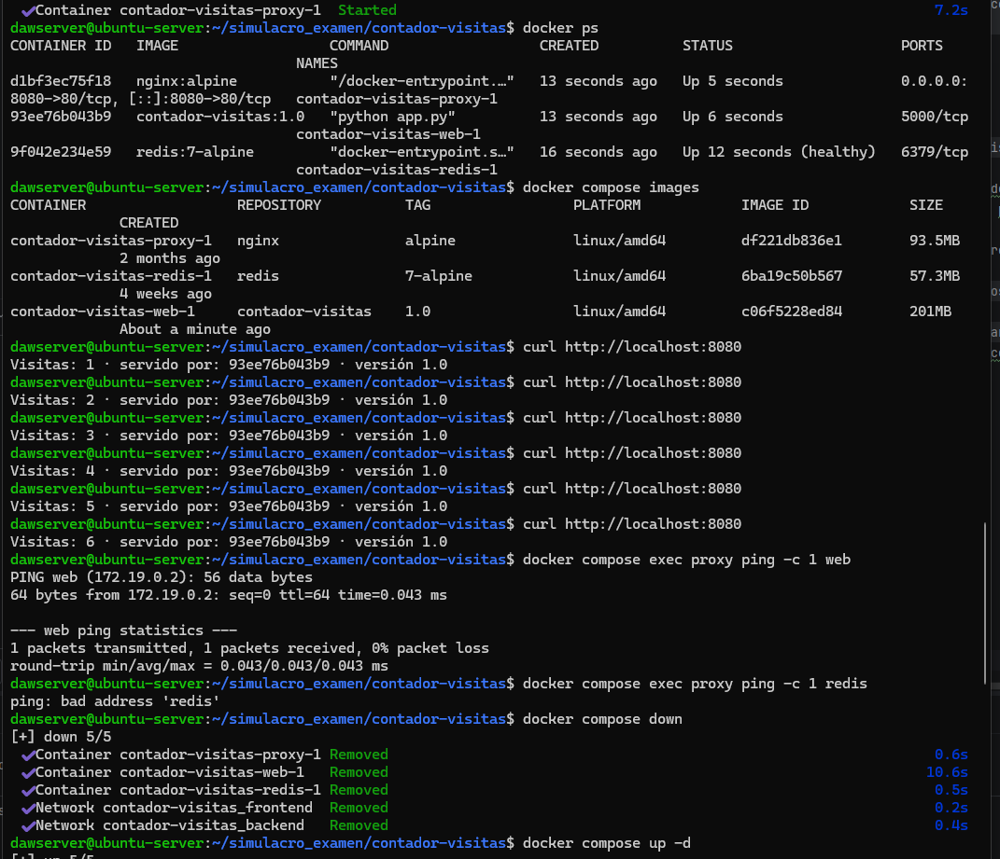
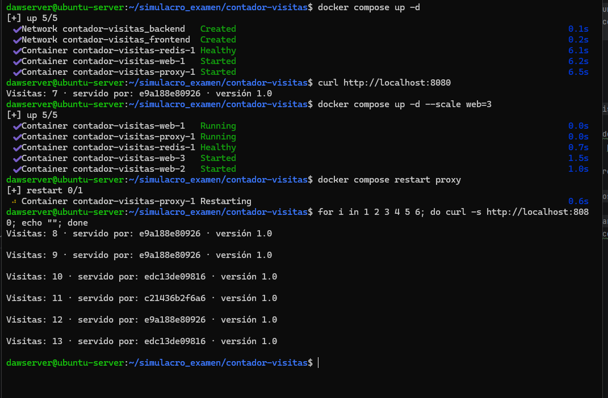

# <Nombre del proyecto>

## Descripción

Aplicación web *multi-contenedor* desarrollada con **<tecnología/framework>** que <explica en una frase qué hace la app>, utilizando **<base de datos/almacén>** para la persistencia y **<servidor web/proxy>** como punto de entrada. El despliegue se gestiona de forma declarativa mediante `Docker Compose`.

## Arquitectura

Los servicios se distribuyen en las redes internas `<red_1>` y `<red_2>` para aislar la capa de datos del acceso exterior:

```text
[Cliente / Navegador]
         |
         | HTTP (puerto <PUERTO_HOST> de la VM -> <PUERTO_CONT_PROXY> del contenedor)
         v
   +-------------+       red: <red_1>       +------------------+
   | <servicio1> | -----------------------> |   <servicio2>    |
   | (<imagen1>) |  http://<servicio2>:<P>  | (<tech> :<PUERTO>)|
   +-------------+                          +------------------+
                                                     |
                                                     | red: <red_2>
                                                     v
                                            +------------------+
                                            |   <servicio3>    |
                                            | (<bd/datos>)     |
                                            +------------------+
```

| Servicio | Imagen | Puerto publicado | Redes |
| :--- | :--- | :---: | ---: |
| `<servicio1>` | `<imagen:tag>` | `<PUERTO_HOST>:<PUERTO_CONT>` | `<red_1>` |
| `<servicio2>` | `<imagen-propia:tag>` *(build `<ruta>`)* | Ninguno *(interno `<PUERTO>`)* | `<red_1>`, `<red_2>` |
| `<servicio3>` | `<imagen-bd:tag>` | Ninguno *(interno `<PUERTO_BD>`)* | `<red_2>` |

## Requisitos

- **Docker Engine** y el plugin **Docker Compose** (`docker compose version`).
- Herramienta `curl` para comprobar las respuestas HTTP.
- Puerto `<PUERTO_HOST>` libre en la máquina anfitriona.

## Puesta en marcha

1. Accede al directorio del proyecto:
   ```bash
   cd ~/<ruta_proyecto>
   ```

2. Crea el archivo `.env` a partir de la plantilla con tus valores locales:
   ```bash
   cat > .env << 'EOF'
   <VARIABLE_1>=<valor-de-ejemplo>
   <VARIABLE_2>=<valor-de-ejemplo>
   EOF
   ```

3. Valida la sintaxis de `compose.yaml` y la sustitución de variables:
   ```bash
   docker compose config
   ```

4. Construye las imágenes necesarias y levanta los servicios en segundo plano:
   ```bash
   docker compose up -d --build
   ```

5. Comprueba el estado de los contenedores y su estado de salud (`healthy`):
   ```bash
   docker compose ps
   ```

## Configuración

Variables definidas en el archivo `.env` agrupadas por servicio *(sin incluir contraseñas reales)*:

- Servicio `<servicio3>`
  - `<VARIABLE_CLAVE>`: contraseña obligatoria para autenticar el servicio y su *healthcheck*.
- Servicio `<servicio2>`
  - `<VARIABLE_CLAVE>`: misma contraseña para conectar con `<servicio3>`.
  - `<VARIABLE_APP>`: parámetro de configuración de la aplicación (por ejemplo, versión o entorno).

> **Aviso de seguridad:** No subas nunca el archivo `.env` a Git ni lo copies dentro de una imagen Docker. Añádelo siempre a `.gitignore` y comparte únicamente un archivo `.env.example` con valores ficticios.

## Comprobación

Lista de verificaciones que debe completar quien despliega el proyecto:

- [ ] Ejecutar `docker compose ps` y confirmar que todos los servicios están `Up` y `<servicio3>` figura como `healthy`.
- [ ] Lanzar peticiones con `curl http://localhost:<PUERTO_HOST>` y verificar la respuesta esperada.
- [ ] Confirmar que los puertos internos no publicados no responden desde el exterior.
- [ ] Verificar el aislamiento de redes mediante `docker compose exec <servicio1> ping -c 1 <servicio2>` y comprobar que `<servicio3>` no es alcanzable desde `<servicio1>`.
- [ ] Comprobar la persistencia ejecutando `docker compose down` seguido de `docker compose up -d`.


## Referencias

- [Documentación oficial de Docker Compose](https://docs.docker.com/compose/)
- [Documentación oficial de Nginx](https://nginx.org/en/docs/)
- [Documentación oficial de Redis](https://redis.io/docs/latest/)








